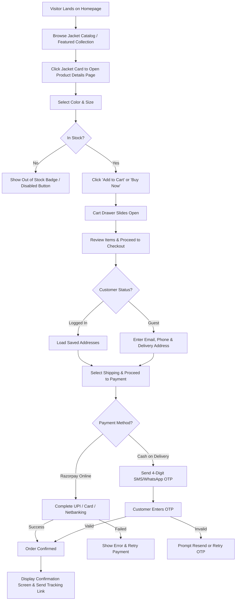
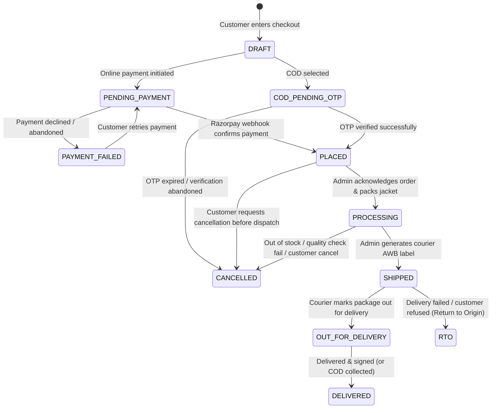
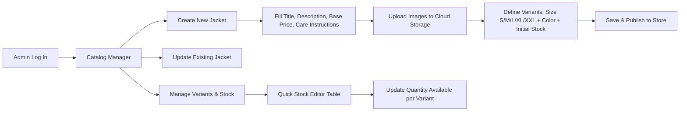
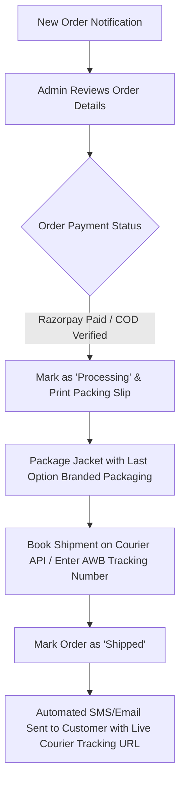

# User Flows: Last Option (Customer & Admin)

**Document Version:** 1.0  
**Context:** Detailed journey maps and state transitions for store customers and administrators.

---

## 1. Customer Journey Flows

### Flow 1.1: Product Discovery to Purchase (Core Funnel)

---

### Flow 1.2: Guest vs. Logged-in Checkout Comparison

| Step | Logged-in Customer | Guest Shopper |
| :--- | :--- | :--- |
| **Identification** | Already recognized via session/JWT | Enters Email + 10-digit Mobile number |
| **Address** | Selects from saved addresses with 1 click | Enters Shipping Address (Pincode auto-populates City/State) |
| **Cart Storage** | Stored in PostgreSQL DB (cross-device sync) | Stored in Browser `localStorage` (transfers to DB on order creation) |
| **Order History** | Viewable in `/account/orders` dashboard | Trackable via secure link sent to Email/SMS (`/track?id=...&token=...`) |
| **Post-Purchase** | Can reorder or edit saved addresses anytime | Prompted: "Create a password to save your details for next time" (optional) |

---

### Flow 1.3: Cash on Delivery (COD) OTP Verification Flow
To protect the store from unverified addresses and fake orders:
1. Customer selects **Cash on Delivery**.
2. A lightweight modal pops up: *"We sent a 4-digit verification code to +91 XXXXX XXXXX"*.
3. Background backend sends a short-lived (5-minute expiry) OTP via SMS / WhatsApp service.
4. Customer enters the 4 digits:
   - **Correct:** The order state immediately switches from `COD_PENDING_OTP` to `PLACED`, stock is reserved, and confirmation is displayed.
   - **Incorrect:** Clear error displayed with a countdown timer to request a fresh OTP.

---

## 2. Order Lifecycle & Status Transitions

Every order moves through a clear set of statuses. This makes it easy for both the customer and admin to know exactly where a parcel is.

---

## 3. Administrator Workflows

The admin panel is accessible at `/admin` for authenticated users with the `admin` role.

### Flow 3.1: Product & Inventory Management

### Flow 3.2: Order Fulfillment & Dispatch

