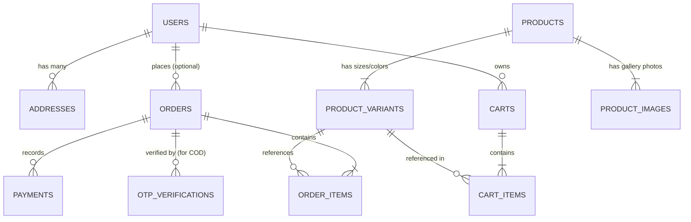

# PostgreSQL Database Schema: Last Option

**Document Version:** 1.0  
**Target Engine:** PostgreSQL 15+  
**ORM Recommendation:** Prisma or Drizzle ORM (Type-safe with TypeScript)

---

## 1. Overview & Core Philosophy
The database is designed with three core principles:
1. **Financial Integrity:** Prices are stored as **integers in Paise** (1 Rupee = 100 paise; e.g., ₹4,999 is stored as `499900`). This completely avoids floating-point rounding errors common in monetary calculations.
2. **Immutable Order Snapshots:** When an order is placed, customer details, product title, price, and shipping address are **snapshotted** into the order records. If an admin later edits a product price or the customer edits their profile address, past orders remain legally accurate and uncorrupted.
3. **Guest & User Flexibility:** Orders can link to a registered user (`user_id`) or remain unlinked for guest checkouts, with access controlled via a cryptographically secure `tracking_token`.

---

## 2. Entity-Relationship (ER) Diagram



---

## 3. Detailed Table Specifications

### 3.1. `users` (Store Accounts & Administrators)
Stores customer accounts and store admin credentials.
```sql
CREATE TABLE users (
    id UUID PRIMARY KEY DEFAULT gen_random_uuid(),
    email VARCHAR(255) UNIQUE NOT NULL,
    phone VARCHAR(20),
    password_hash VARCHAR(255) NOT NULL,
    first_name VARCHAR(100),
    last_name VARCHAR(100),
    role VARCHAR(20) NOT NULL DEFAULT 'customer', -- 'customer' or 'admin'
    created_at TIMESTAMP WITH TIME ZONE DEFAULT NOW(),
    updated_at TIMESTAMP WITH TIME ZONE DEFAULT NOW()
);
```

### 3.2. `addresses` (Saved Shipping Destinations)
Stores address books for registered customers.
```sql
CREATE TABLE addresses (
    id UUID PRIMARY KEY DEFAULT gen_random_uuid(),
    user_id UUID NOT NULL REFERENCES users(id) ON DELETE CASCADE,
    full_name VARCHAR(200) NOT NULL,
    phone VARCHAR(20) NOT NULL,
    address_line1 VARCHAR(255) NOT NULL,
    address_line2 VARCHAR(255),
    landmark VARCHAR(150),
    city VARCHAR(100) NOT NULL,
    state VARCHAR(100) NOT NULL,
    pincode VARCHAR(10) NOT NULL,
    is_default BOOLEAN NOT NULL DEFAULT FALSE,
    created_at TIMESTAMP WITH TIME ZONE DEFAULT NOW(),
    updated_at TIMESTAMP WITH TIME ZONE DEFAULT NOW()
);
```

### 3.3. `products` (Parent Jacket Catalog)
Stores high-level jacket details.
```sql
CREATE TABLE products (
    id UUID PRIMARY KEY DEFAULT gen_random_uuid(),
    title VARCHAR(255) NOT NULL,
    slug VARCHAR(255) UNIQUE NOT NULL,        -- e.g. "classic-bomber-jacket-black"
    description TEXT NOT NULL,
    materials_and_care TEXT,                  -- Fabric composition, washing rules
    base_price INTEGER NOT NULL,              -- Stored in paise (e.g. 399900 = ₹3,999)
    compare_at_price INTEGER,                 -- Strikethrough price for discounts
    is_published BOOLEAN NOT NULL DEFAULT FALSE,
    created_at TIMESTAMP WITH TIME ZONE DEFAULT NOW(),
    updated_at TIMESTAMP WITH TIME ZONE DEFAULT NOW()
);
```

### 3.4. `product_images` (Photo Gallery)
Stores high-resolution jacket imagery hosted on cloud storage (Cloudinary / S3).
```sql
CREATE TABLE product_images (
    id UUID PRIMARY KEY DEFAULT gen_random_uuid(),
    product_id UUID NOT NULL REFERENCES products(id) ON DELETE CASCADE,
    image_url TEXT NOT NULL,
    alt_text VARCHAR(255),
    display_order INTEGER NOT NULL DEFAULT 0,
    is_primary BOOLEAN NOT NULL DEFAULT FALSE
);
```

### 3.5. `product_variants` (Size, Color & Real-Time Stock)
A jacket comes in multiple sizes (S, M, L, XL, XXL) and colors. Each combination has its own inventory count.
```sql
CREATE TABLE product_variants (
    id UUID PRIMARY KEY DEFAULT gen_random_uuid(),
    product_id UUID NOT NULL REFERENCES products(id) ON DELETE CASCADE,
    sku VARCHAR(100) UNIQUE NOT NULL,          -- e.g. "LO-JKT-BOMB-BLK-M"
    size VARCHAR(20) NOT NULL,                 -- 'S', 'M', 'L', 'XL', 'XXL'
    color_name VARCHAR(50) NOT NULL,           -- e.g. "Midnight Black", "Olive Drab"
    color_hex VARCHAR(10) NOT NULL,            -- e.g. "#1A1A1A"
    price_override INTEGER,                    -- Nullable; overrides base_price if special edition
    stock_quantity INTEGER NOT NULL DEFAULT 0, -- Active units in warehouse
    created_at TIMESTAMP WITH TIME ZONE DEFAULT NOW(),
    updated_at TIMESTAMP WITH TIME ZONE DEFAULT NOW(),
    CONSTRAINT stock_non_negative CHECK (stock_quantity >= 0)
);
```

### 3.6. `carts` & `cart_items` (Shopping Cart State)
Persists shopping cart items for logged-in users and synchronizes across sessions.
```sql
CREATE TABLE carts (
    id UUID PRIMARY KEY DEFAULT gen_random_uuid(),
    user_id UUID UNIQUE REFERENCES users(id) ON DELETE CASCADE,
    created_at TIMESTAMP WITH TIME ZONE DEFAULT NOW(),
    updated_at TIMESTAMP WITH TIME ZONE DEFAULT NOW()
);

CREATE TABLE cart_items (
    id UUID PRIMARY KEY DEFAULT gen_random_uuid(),
    cart_id UUID NOT NULL REFERENCES carts(id) ON DELETE CASCADE,
    variant_id UUID NOT NULL REFERENCES product_variants(id) ON DELETE CASCADE,
    quantity INTEGER NOT NULL DEFAULT 1,
    created_at TIMESTAMP WITH TIME ZONE DEFAULT NOW(),
    updated_at TIMESTAMP WITH TIME ZONE DEFAULT NOW(),
    CONSTRAINT unique_cart_variant UNIQUE (cart_id, variant_id),
    CONSTRAINT quantity_positive CHECK (quantity > 0)
);
```

### 3.7. `orders` (Confirmed Sales & Tracking)
Central record for all customer purchases.
```sql
CREATE TABLE orders (
    id UUID PRIMARY KEY DEFAULT gen_random_uuid(),
    order_number VARCHAR(50) UNIQUE NOT NULL,   -- e.g. "LO-2026-1042"
    tracking_token VARCHAR(64) UNIQUE NOT NULL, -- Random secret for guest URL tracking
    user_id UUID REFERENCES users(id) ON DELETE SET NULL, -- Null for guest checkouts
    customer_email VARCHAR(255) NOT NULL,
    customer_phone VARCHAR(20) NOT NULL,
    
    status VARCHAR(30) NOT NULL DEFAULT 'PLACED',
    -- 'PENDING_PAYMENT', 'COD_PENDING_OTP', 'PLACED', 'PROCESSING', 'SHIPPED', 'DELIVERED', 'CANCELLED', 'RTO'
    
    payment_method VARCHAR(30) NOT NULL,       -- 'ONLINE_RAZORPAY' or 'CASH_ON_DELIVERY'
    payment_status VARCHAR(30) NOT NULL DEFAULT 'PENDING', -- 'PENDING', 'PAID', 'FAILED', 'REFUNDED'
    
    subtotal INTEGER NOT NULL,                 -- Items total in paise
    shipping_fee INTEGER NOT NULL DEFAULT 0,   -- Courier fee in paise
    total_amount INTEGER NOT NULL,             -- Final grand total in paise
    
    shipping_address_snapshot JSONB NOT NULL,  -- Immutable JSON copy of delivery address
    
    courier_name VARCHAR(100),                 -- e.g. "Delhivery", "Blue Dart"
    courier_awb VARCHAR(100),                  -- Waybill / tracking number
    courier_tracking_url TEXT,                 -- Direct live tracking link
    
    notes TEXT,                                -- Internal admin notes
    created_at TIMESTAMP WITH TIME ZONE DEFAULT NOW(),
    updated_at TIMESTAMP WITH TIME ZONE DEFAULT NOW()
);
```

### 3.8. `order_items` (Purchased Products Snapshot)
Preserves the exact item details, price, and variant at the moment of payment.
```sql
CREATE TABLE order_items (
    id UUID PRIMARY KEY DEFAULT gen_random_uuid(),
    order_id UUID NOT NULL REFERENCES orders(id) ON DELETE CASCADE,
    variant_id UUID REFERENCES product_variants(id) ON DELETE SET NULL,
    product_title VARCHAR(255) NOT NULL,
    variant_sku VARCHAR(100) NOT NULL,
    size VARCHAR(20) NOT NULL,
    color_name VARCHAR(50) NOT NULL,
    unit_price INTEGER NOT NULL,               -- Price per unit in paise
    quantity INTEGER NOT NULL,
    total_price INTEGER NOT NULL,              -- unit_price * quantity in paise
    thumbnail_url TEXT
);
```

### 3.9. `payments` (Gateway Transactions & Audit)
Stores Razorpay or COD payment verification logs and webhook payloads.
```sql
CREATE TABLE payments (
    id UUID PRIMARY KEY DEFAULT gen_random_uuid(),
    order_id UUID NOT NULL REFERENCES orders(id) ON DELETE CASCADE,
    provider VARCHAR(50) NOT NULL,             -- 'RAZORPAY', 'COD'
    provider_order_id VARCHAR(100),            -- Razorpay order_id (e.g. order_K3H478...)
    provider_payment_id VARCHAR(100),          -- Razorpay payment_id (e.g. pay_2901...)
    provider_signature VARCHAR(255),          -- Cryptographic HMAC signature
    amount INTEGER NOT NULL,                   -- In paise
    currency VARCHAR(10) NOT NULL DEFAULT 'INR',
    status VARCHAR(30) NOT NULL,               -- 'INITIATED', 'SUCCESS', 'FAILED'
    raw_payload JSONB,                         -- Full webhook payload for disputes
    created_at TIMESTAMP WITH TIME ZONE DEFAULT NOW()
);
```

### 3.10. `otp_verifications` (COD Anti-Fraud Verification)
Handles 4-digit verification codes for Cash on Delivery orders.
```sql
CREATE TABLE otp_verifications (
    id UUID PRIMARY KEY DEFAULT gen_random_uuid(),
    phone VARCHAR(20) NOT NULL,
    otp_code_hash VARCHAR(255) NOT NULL,       -- Hashed with bcrypt for security
    purpose VARCHAR(50) NOT NULL DEFAULT 'COD_CONFIRMATION',
    order_id UUID REFERENCES orders(id) ON DELETE CASCADE,
    expires_at TIMESTAMP WITH TIME ZONE NOT NULL,
    is_used BOOLEAN NOT NULL DEFAULT FALSE,
    attempts INTEGER NOT NULL DEFAULT 0,
    created_at TIMESTAMP WITH TIME ZONE DEFAULT NOW()
);
```

---

## 4. Why This Schema Works (Plain Language Explanation)

1. **Why `products` and `product_variants` are separate:**  
   A jacket like the "Heritage Bomber" has a single description, story, and base photos. However, customers buy a specific combination: e.g. **Size L in Onyx Black**. Separating variants ensures the inventory of Size L can reach 0 without making the entire jacket appear sold out for customers wanting Size M.

2. **Why `shipping_address_snapshot` is stored as JSONB:**  
   If a customer moves to a new city six months later and edits their address book, we cannot alter where their previous jacket was shipped. Freezing the address as a JSON document inside the order guarantees legal and audit compliance.

3. **Why `tracking_token` exists for orders:**  
   A guest buyer does not have an account password. When we email or SMS them an order confirmation, the link contains a long, unpredictable random key (`/orders/track?id=...&token=...`). Only someone with that token can view the order, keeping their address and phone number private without forcing them to register.
